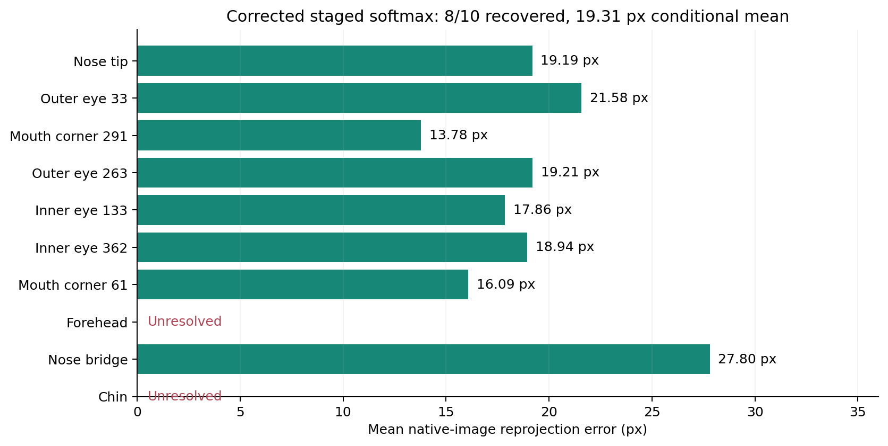
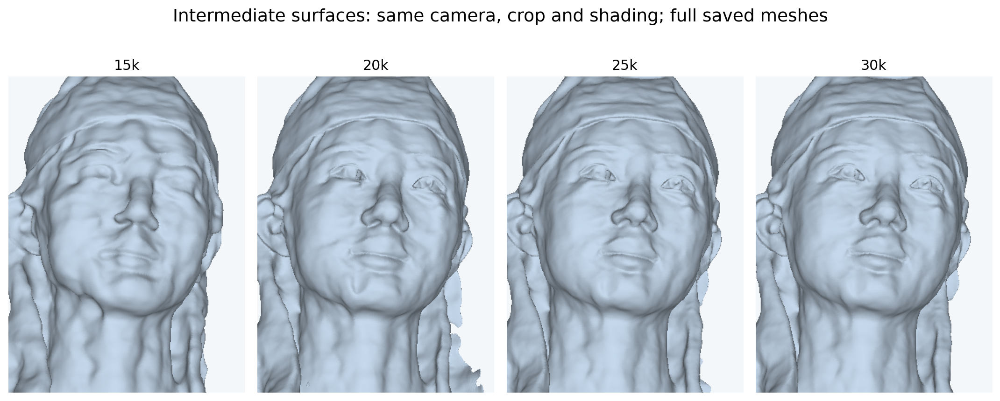

# Working softmax landmark snapshot: corrected staged 10-landmark Factored-NeuS

This branch preserves the **exact Stage 1 implementation used for
`exp/122_1_masked/staged_10_corrected/geometry`**, not the later 478-landmark
experiments. Its 64 recorded source/configuration files match the original run
manifest byte for byte. Additional tools make the snapshot portable and verify
the archived inputs/results without changing the training implementation.

**Result: 8/10 landmarks recovered; 19.31 native-pixel mean reprojection error
on those eight.** Forehead and chin remain unresolved. This is a useful partial
success, not a claim of perfect ten-landmark localization or improved geometry.



## Start here

```bash
git clone --branch softmax_10landmark_working --single-branch \
  https://github.com/RulerOfEternalNight/JD-Factored-NeuS.git
cd JD-Factored-NeuS
python3.10 -m venv .venv
source .venv/bin/activate
python -m pip install -r requirements-reproduction.txt
python tools/verify_reproduction.py --profile source
```

The verified runtime was Python 3.10, PyTorch 1.13.1+cu117, Linux CUDA and an
RTX 4070 Laptop GPU (8 GiB). See [environment and portability notes](docs/REPRODUCIBILITY.md).
The existing upstream `requirements.txt` is historical; use the reproduction file.

## Restore the exact saved model/results

Large artifacts are release assets, not Git blobs:

[Download the versioned working-model release](https://github.com/RulerOfEternalNight/JD-Factored-NeuS/releases/tag/softmax-10landmark-working-v1).

```bash
mkdir -p downloads
gh release download softmax-10landmark-working-v1 \
  --repo RulerOfEternalNight/JD-Factored-NeuS \
  --pattern staged10-working-artifacts-v1.tar.gz --pattern SHA256SUMS \
  --dir downloads
(cd downloads && sha256sum -c SHA256SUMS)
python tools/restore_artifacts.py --archive downloads/staged10-working-artifacts-v1.tar.gz
python tools/verify_reproduction.py --profile artifacts
```

The bundle restores all eight saved head/joint checkpoints, intermediate meshes,
final meshes/landmarks, floating-point export heatmaps, scalar logs and periodic
landmark heatmaps, plus the required baseline checkpoint/reference mesh. The
tracked manifest verifies every file. Different existing results are never
overwritten. **Source photos and any overlays containing them are excluded.**

## Repeat training using the private original dataset

Put the original images, masks and calibration under `public_data/122_1_masked/`.
These photos are deliberately not published. Dataset and baseline hashes must
match `reproducibility/inputs_manifest.json`.

```bash
python tools/verify_reproduction.py --profile inputs
python tools/check_saved_model.py       # Read-only golden CUDA inference check
python tools/run_staged10.py train      # Fresh separate output directory
```

For background training:

```bash
tmux new -d -s staged10-reproduction \
  'source .venv/bin/activate && python -u tools/run_staged10.py train > reproduction.log 2>&1'
```

This starts from **baseline 10k**, freezes reconstruction until **15k**, then
jointly trains to **30k**, with a fresh 10-class landmark head. It preserves
sigma **20**, batch **512**, native **1728 x 2592** training images and original
validation settings. New output goes to
`exp/122_1_masked/staged_10_reproduction/geometry`, keeping archived results safe.

```bash
python tools/run_staged10.py resume
python tools/run_staged10.py validate   # Landmark camera index 1
python tools/run_staged10.py export
```

Archived artifact restoration is byte-exact. Fresh training on another GPU or
software stack is **not guaranteed bitwise identical**, even with seed 42.
The original dataset is necessary for retraining or rendering photo-based
diagnostics; a Git checkout alone does not contain those private inputs.

## Results and detailed analysis

- [Method and exact configuration](docs/METHOD.md)
- [Final results and evaluation limitations](docs/RESULTS.md)
- [All intermediate results and their interpretation](docs/INTERMEDIATE_RESULTS.md)
- [Reproduction, checkpoint restoration and environment](docs/REPRODUCIBILITY.md)
- [Known limitations and what this snapshot does not establish](docs/KNOWN_LIMITATIONS.md)
- [Printable working-implementation record](docs/WORKING_IMPLEMENTATION.pdf)
- [Machine-readable final results](results/landmarks.json)



## Tests

```bash
python tests/smoke_training.py           # Small synthetic fixture; no real photos
python -m unittest discover -s tests -v
```

The preserved code plus reproduction tools passed **52 tests** and a real-data
golden inference check. Tests requiring the private dataset skip when unavailable.
The synthetic smoke generates ignored fixtures under `verification/`.

## Attribution

This is a research extension of Factored-NeuS, focused on Stage 1 geometry and
appearance. The original upstream README is preserved in
[UPSTREAM_README.md](UPSTREAM_README.md). Later illumination/material stages are
not changed by the landmark experiment. Legacy configurations remain for source
fidelity; this branch's documented working recipe is `confs/staged_10_corrected.conf`.
