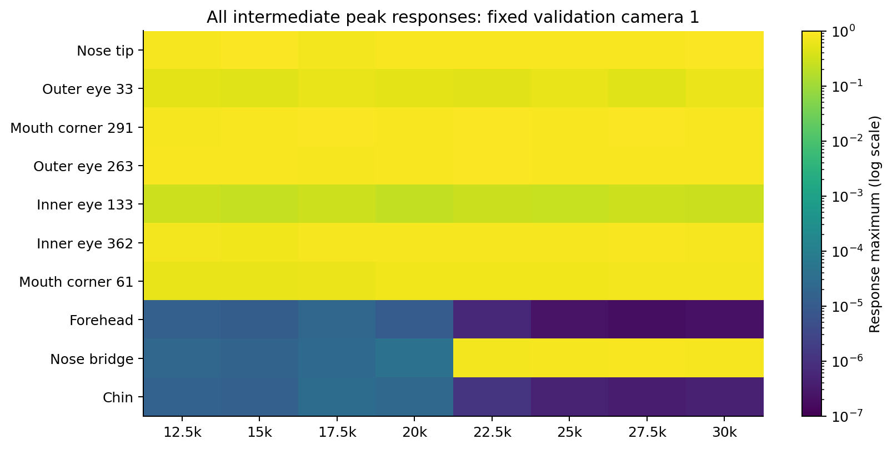
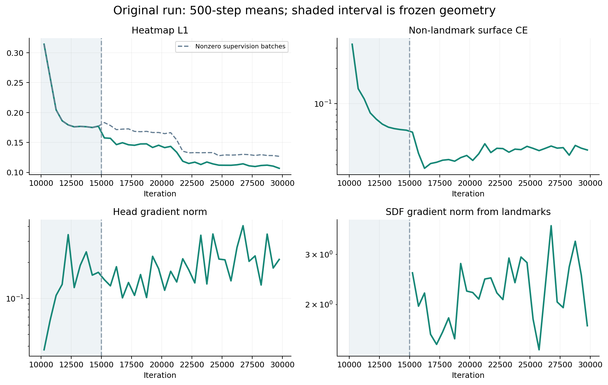
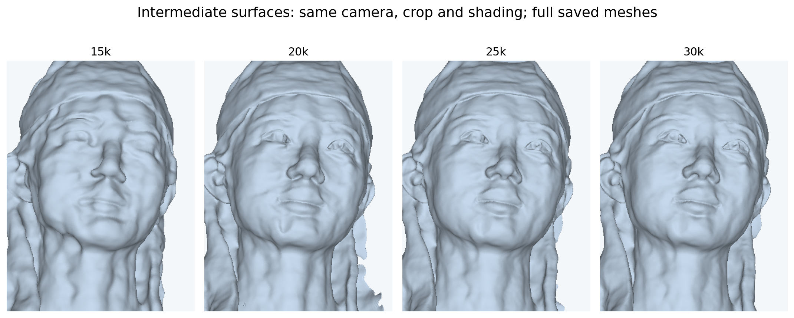
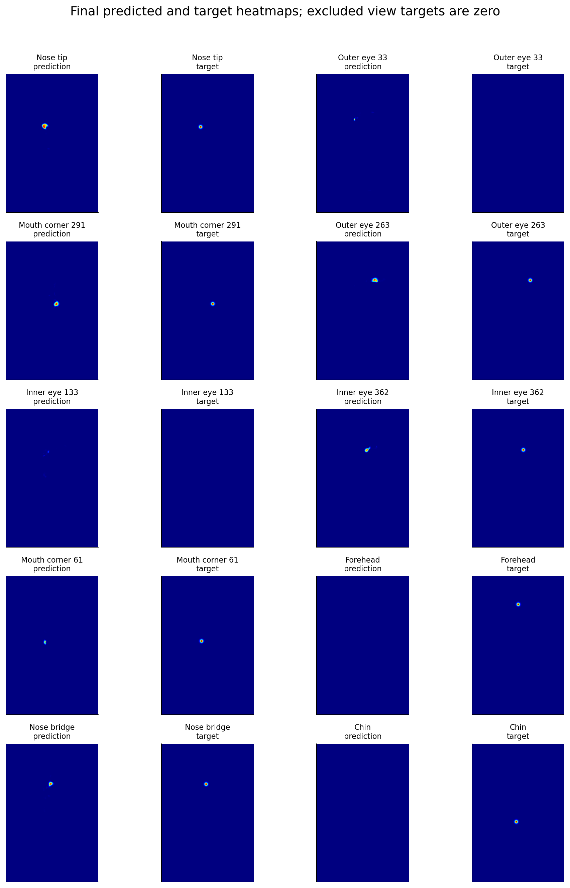
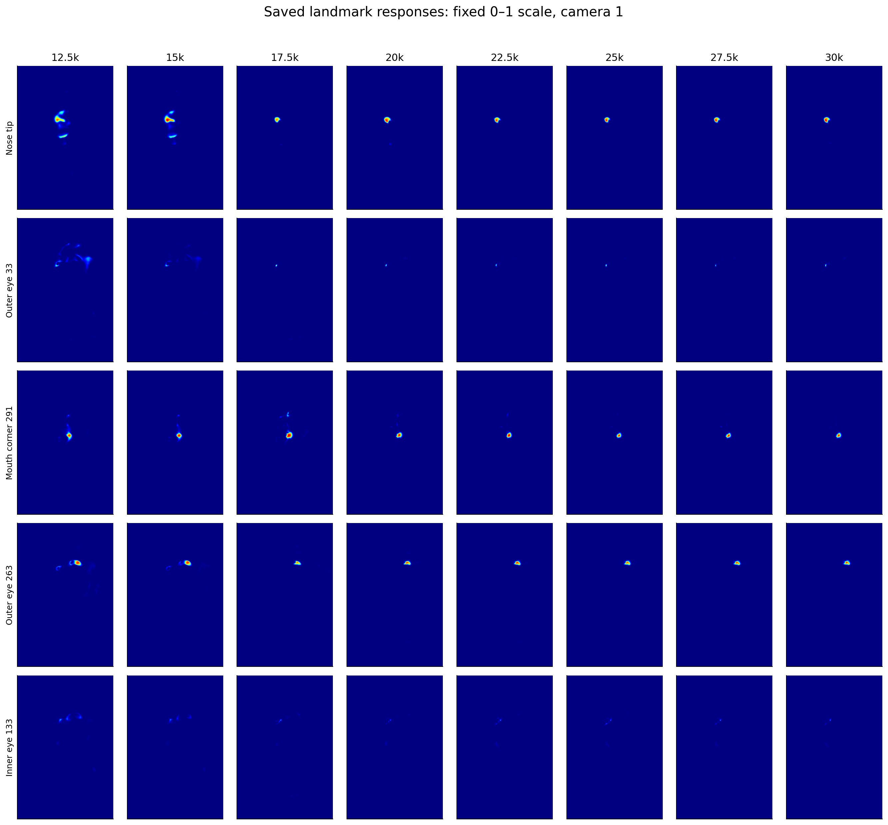
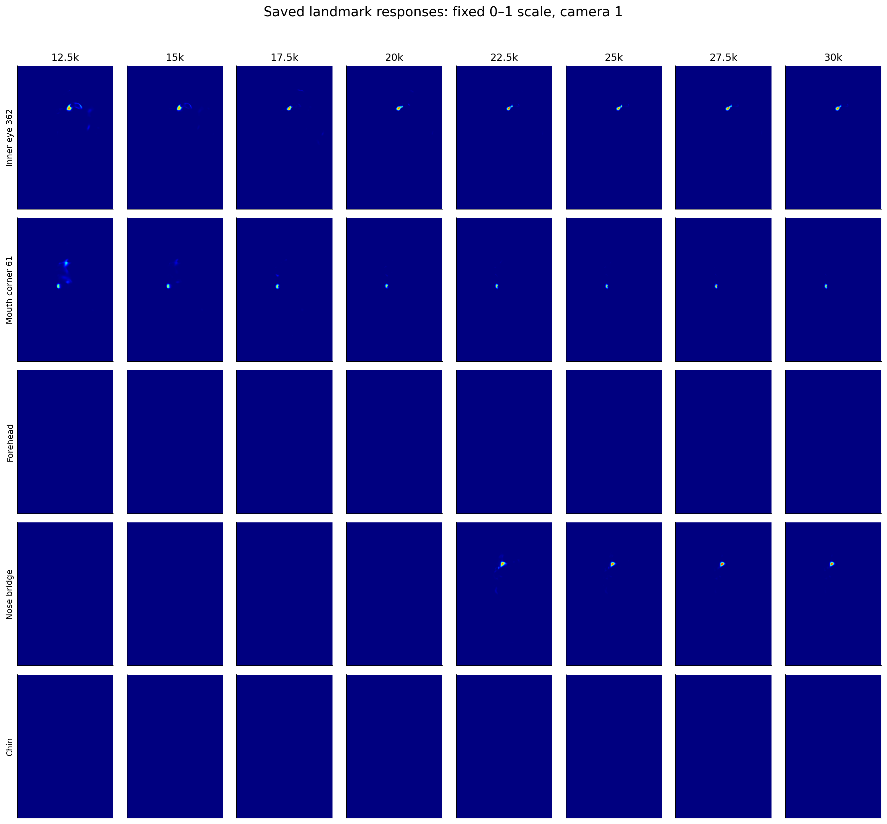

# Intermediate results and detailed analysis

The original run saved eight landmark validations, all at **camera index 1**
(`001.png`) and 432 × 648. RGB validation used random cameras. The table below
counts classes with maximum response >0.05. These are response magnitudes, not
localization accuracy or the final multi-view acceptance count.

| Iteration | Classes above 0.05 | Median peak | Highest peak | Training phase |
|---:|---:|---:|---:|---|
| 12,500 | 7/10 | 0.55259 | 0.83036 | Head only / transition |
| 15,000 | 7/10 | 0.52375 | 0.89113 | Head only / transition |
| 17,500 | 7/10 | 0.61166 | 0.91631 | Joint |
| 20,000 | 7/10 | 0.60418 | 0.87039 | Joint |
| 22,500 | 8/10 | 0.73647 | 0.90505 | Joint |
| 25,000 | 8/10 | 0.74074 | 0.86905 | Joint |
| 27,500 | 8/10 | 0.80238 | 0.88692 | Joint |
| 30,000 | 8/10 | 0.78267 | 0.89151 | Joint |

## What changed during training

Nose, eye and mouth responses emerge during frozen-geometry head training.
The nose bridge is initially weak and becomes active later during joint training.
Forehead and chin remain weak through the final checkpoint. Strong maxima alone
cannot establish correct position; inspect the final multi-camera reprojection
results alongside response maps.

## Learning curves and a logging caveat

The all-batch heatmap L1 falls from approximately 0.3142 in the first 500 steps
to 0.1067 in the last 500. The last-window mean non-landmark CE is 0.04015.
Landmark-gradient norms remain nonzero: final-window head mean 0.2120 and SDF
mean 1.6841 (five diagnostic probes each). These are landmark-objective gradients
before multiplication by the outer lambda, independently of reconstruction loss.

The 15k loss transition must be interpreted carefully. Head warm-up uses only
annotated views; joint training mixes 50% explicitly annotated cameras with the
ordinary image permutation. Thirteen of 48 views have no valid landmark labels,
so about 13.54% of joint batches are expected to contribute zero heatmap loss.
The dashed conditioned curve removes zero-supervision batches. Its decline still
supports sparse learning, but the sudden all-batch drop is partly a sampler effect.

## Geometry progression

The four actual meshes use a fixed calibrated camera, crop and shading, without
smoothing or decimation. At 15k, geometry is still bitwise identical to baseline
10k; later SDF/appearance parameters update jointly. No reference geometry exists,
so these panels demonstrate progression, not quantified anatomical improvement.

## Final predictions and Gaussian targets

Each predicted/target pair uses the original fixed 0–1 colormap. Camera-1 targets
for excluded annotations are zero and are ignored during training, rather than
treated as negative detections. Response maxima in JSON retain float precision;
the PNGs are quantized to 8 bits.

## Every saved intermediate heatmap

All 80 response maps are shown below without per-image contrast normalization.
They contain only model heatmaps; no source photos are embedded.

## Why this version is worth preserving

The corrections address domain leakage, unreliable non-landmark rejection and
visibility-biased candidate ranking. The combined run recovered eight useful
landmarks. It is not a controlled causal ablation of each correction, and it
does not establish that the same loss/softmax scaling works for hundreds of
densely overlapping landmark classes. Preserve this branch as the sparse control.
