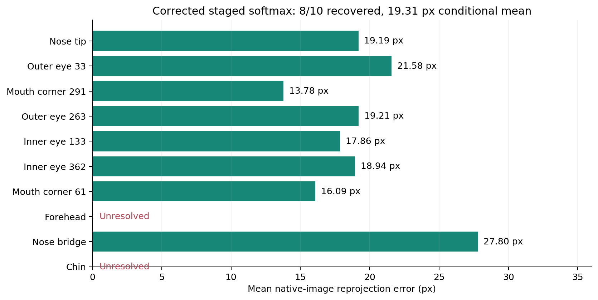

# Final results: original corrected staged 10-landmark run

## Quantitative results

- Selected: **8/10 (80%)**.
- Conditional mean reprojection error: **19.3065 native pixels**.
- Conditional median: **12.3729 native pixels**.
- Original detector-valid observations for selected classes: **280**.
- Reviewed-subset mean: **14.1458 px** on **223** observations.
- Coverage-aware PCK at 20 px: **56.00%**, using all **350** original observations; unresolved counts as failure.

These are training-view detector-agreement metrics. The reviewed subset is
secondary; the main error retains original valid detections, preventing filtering
from silently changing the headline evaluation population. Unresolved errors are
undefined and must never be substituted with zero.

| ID | Landmark | Selected | Mean error (native px) |
|---:|---|---|---:|
| 1 | nose_tip | Yes | 19.1890 |
| 33 | outer_eye_corner_mp33 | Yes | 21.5823 |
| 291 | mouth_corner_mp291 | Yes | 13.7800 |
| 263 | outer_eye_corner_mp263 | Yes | 19.2057 |
| 133 | inner_eye_corner_mp133 | Yes | 17.8620 |
| 362 | inner_eye_corner_mp362 | Yes | 18.9427 |
| 61 | mouth_corner_mp61 | Yes | 16.0866 |
| 10 | forehead_center_mp10 | No | Undefined |
| 168 | nose_bridge_mp168 | Yes | 27.8041 |
| 152 | chin_mp152 | No | Undefined |

## Interpretation

The model localizes nose, eye corners, mouth corners and bridge usefully in this
dataset. Forehead (10) and chin (152) remain unresolved. This demonstrates sparse
localization feasibility, not a complete anatomical reconstruction solution.

All exported accepted landmarks are mesh vertices; surface distance zero is
guaranteed by the extraction design and is not an independent accuracy score.
The model-to-baseline surface difference is 0.006865 input world units using
50,000 seeded surface samples. It measures change, not improvement, because
there is no independent reference mesh.

## Files and provenance

The public release restores `geometry/checkpoints`, `geometry/meshes`, final
`geometry/exports/00030000` numerical/mesh/float-heatmap files, scalar logs and
all periodic landmark response/target comparisons. Source photos, RGB validation
composites, `annotations.png` photo overlays and photographic reprojections are
not published. They remain in the local original experiment/private backup.

The authoritative numbers are in [`results/landmarks.json`](../results/landmarks.json).
See [`results/summary.json`](../results/summary.json) and the original run manifest
under `reproducibility/`. The archived final checkpoint and every artifact have
SHA-256 entries in the tracked manifests.
